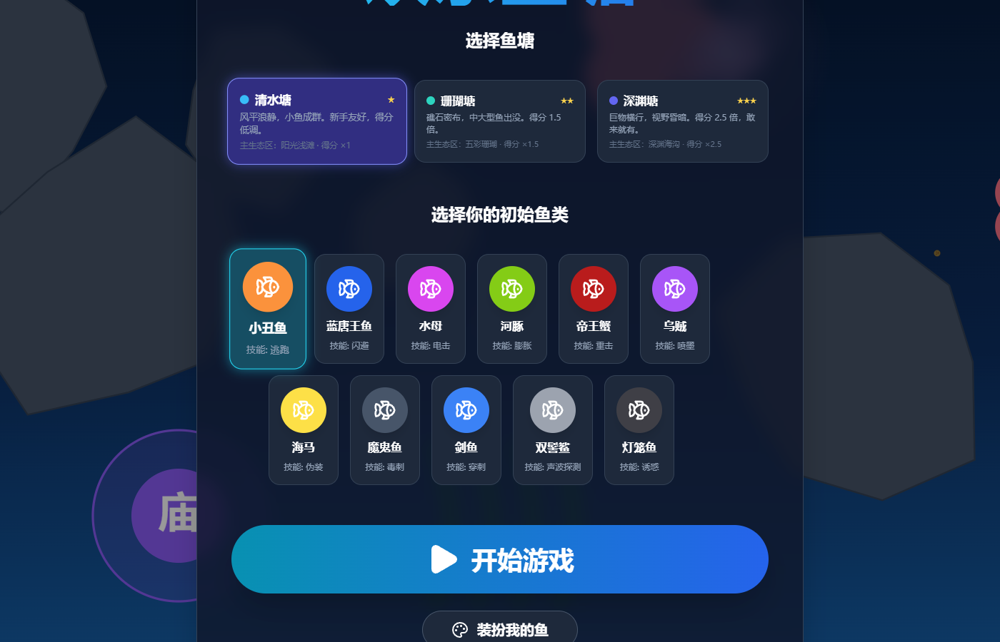

# 欢乐鱼塘 🐟

一个跑在浏览器里的「大鱼吃小鱼」休闲游戏：鼠标操控、吃鱼成长、进化分支、战队收编、四个生态区、三个可选鱼塘。
纯前端（React + TypeScript + PixiJS），无后端、无外部资源、无音频文件（音效由 WebAudio 现场合成）。默认使用 PixiJS WebGL 渲染，`?renderer=canvas` 可切回旧 Canvas 路径。



---

## 快速开始

```bash
npm install       # 安装依赖
npm run dev       # 开发服务器 → http://localhost:3000
```

| 命令 | 作用 |
|---|---|
| `npm run dev` | 开发服务器（Vite，端口 3000） |
| `npm run build` | 生产构建 → `dist/` |
| `npm run preview` | 预览生产构建 |
| `npm run typecheck` | 类型检查（`tsc --noEmit`） |
| `npm run test` | 单元测试（Vitest） |
| `npm run test:e2e` | 端到端测试（Playwright） |

## 操作

| 键 | 作用 |
|---|---|
| 鼠标 | 决定游向 —— 鱼永远朝光标游 |
| `Space` | 加速冲刺（耗体力） |
| `Q` | 释放流派技能 |
| `E` | 与建筑交互（进商场换装） |
| `R` | 切换当前战队成员 |
| `G` | 无敌模式（仅调试） |

---

## 玩法要点

- **吃鱼成长**：吃掉比自己小的鱼涨体重，体型决定胜负。大 2 倍以上 80% 直接吞噬，大 1.5 倍 30% 概率。
- **偷袭**：绕到大鱼背后咬尾巴，吞噬概率大增、还能掠夺体型 —— 但大鱼会回头反制。
- **四大流派**：暗杀 / 机动 / 控制 / 成长爆发，每派 4 个技能，按 Lv3/6/9/12 逐档解锁。
- **战队**：吃掉的鱼可收编入队（上限 10），护卫玩家、不互相攻击；本体阵亡时自动夺舍半径最大的成员续命。
- **四个生态区**：阳光浅滩（加速）/ 五彩珊瑚（冷却减半）/ 剧毒沼泽（腐蚀伤害）/ 深渊海沟（视野受限）。
- **三个鱼塘**：清水塘 / 珊瑚塘 / 深渊塘，难度、刷怪、得分倍率与障碍密度各不相同（见下）。
- **成就 12 枚 + 本地排行榜**：跨局累计存 localStorage，排行榜支持分塘筛选。

### 三个鱼塘

| 鱼塘 | 难度 | 主生态区 | 刷怪 tier 加成 | 食物比例 | 得分倍率 | 障碍密度 |
|---|---|---|---|---|---|---|
| 清水塘 CLEAR | ★ | 阳光浅滩 | +0 | 0.40 | ×1.0 | 1.0 |
| 珊瑚塘 CORAL | ★★ | 五彩珊瑚 | +1 | 0.30 | ×1.5 | 1.6 |
| 深渊塘 ABYSS | ★★★ | 深渊海沟 | +2 | 0.20 | ×2.5 | 0.6 |

开局选塘；进入游戏后可走**塘际传送门**换塘 —— 世界内容（障碍 / 门 / 建筑 / 野鱼）整套重建，
而玩家的成长、分数与战队成员会跟着走。

---

## 架构

**兼容门面 + 数据驱动 + 系统注册表**：

```
src/
├── data/       纯数据层（生物 / 技能 / 生态区 / 建筑 / 鱼塘 / 世界数值），加内容只改这里
├── core/       引擎核心（数学 / 容错 safe() / EventBus）
├── systems/    逻辑层，一个系统一个文件；systems/index.ts 是注册表，顺序即执行顺序
├── factories/  状态与实体工厂（createInitialState / createEntity / …）
├── components/ 表现层（Canvas 回退渲染 / UIOverlay 面板 / MiniMap）
├── rendering/  PixiJS 默认渲染器、相机、LOD、缓存与 Canvas/Pixi 选择
└── constants.ts · types.ts · gameEngine.ts   ← 聚合门面，旧导入路径始终可用
```

几条贯穿全局的约定：

- **数据驱动**：`CreatureType = keyof CREATURE_DATA`，加一条数据就自动获得类型、刷怪与渲染。
- **注册表 + 容错**：每个系统都被 `safe()` 包一层，单个系统抛错不会带崩整帧。
- **EventBus 解耦**：逻辑层只发事件，音效 / 成就等订阅消费，互不依赖。
- **一处收口**：加分统一走 `scoreGain(pondId, base)`，避免漏改导致分数对不上。
- **向后兼容铁律**：新功能默认值必须等于旧硬编码，旧调用点与既有测试零改动。

## 开发文档

| 文档 | 内容 |
|---|---|
| **[`开发任务清单.md`](开发任务清单.md)** | **★ 唯一执行入口**：待办分级（P0~P3）、现状实测、验收模板、技术债 |
| [`交付说明.html`](交付说明.html) | **本轮交付说明**（含玩法截图），多鱼塘阶段 1 + 2a |
| [`多鱼塘立项设计.md`](多鱼塘立项设计.md) | 多鱼塘的需求拆解、分阶段方案与风险 |
| [`开发路线图.md`](开发路线图.md) | 架构重构记录 + 各轮迭代与踩坑 |
| [`开发计划.md`](开发计划.md) | 功能**规格**与历史（§十一 优先级表已归档，以任务清单为准） |

`scripts/` 下有各功能的浏览器探针（`probe-*.mjs`）与它们产出的截图，可用作端到端验证的补充。

## 验证现状

- `tsc --noEmit` 干净
- 单测 **227 例 / 17 文件**全部通过
- 生产构建 347.07 kB（gzip 109.55 kB）
- 生产包中不含调试钩子 `__FISH_DEBUG__`
