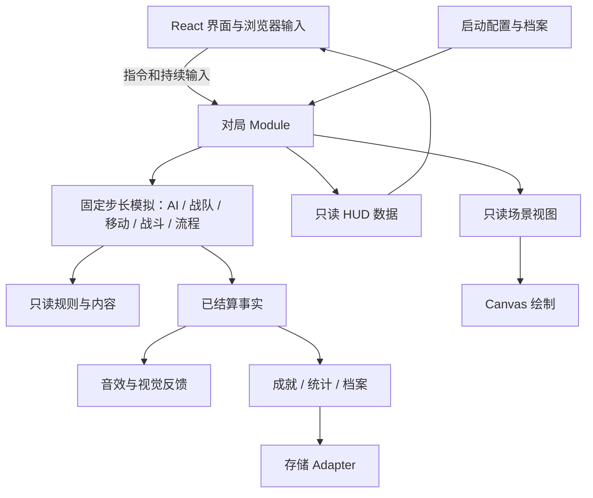

# 欢乐鱼塘 · 架构评估与演进计划

版本：1.0 · 日期：2026-09-14 · 状态：评估与改造建议，尚未实施。

适用范围：当前 React + TypeScript + Vite + Canvas 2D 项目，以及《鱼群争霸开发计划》规划的扩展。评估包含当前未提交的 G0 代码；工作区仍在演进，本文不是某个提交版本的交付证明。

## 1. 结论：可以继续做大，但需要先整理核心职责

**保留现有技术栈，采用渐进改造。当前优先级是对局隔离、规则结算和渲染成本，不是整体更换引擎。**

项目已具备固定步长模拟、分系统执行、数据注册表、空间索引、事件通知、单元测试和浏览器探针，足以作为“鱼群争霸”首版的基础。

主要风险是：虽然文件拆开了，多个系统仍能直接修改同一份共享状态。技能、死亡、成长、UI 和存储的规则交叉，内容越多，隐含的调用顺序越难维护。

| “做大”的具体目标 | 支撑判断 | 必要调整 |
|---|---|---|
| 增加鱼种、技能、事件、成长组合 | 可以支持，维护成本会先暴露问题 | 统一内容注册，收口战斗与奖励 |
| 两支 AI 鱼群、队伍指令、局内成长和塘主战 | 可以在现有系统上实现 | 对局实例、阵营、指令、死亡归属 |
| 多张地图，一次只运行一个鱼塘 | 可以支持；不同形状和尺寸需改造 | 地图参数跟随世界实例，避免模块级常量锁死 |
| 同时运行多个鱼塘、大量远处生态 | 当前没有完整支持 | 实例隔离、分区状态、远近模拟频率和预算 |
| 千级复杂鱼同屏、多人群频繁放技能 | 没有证据支持，不能直接提高上限承诺效果 | 压测、画面分级、批量绘制，必要时换渲染实现 |
| 小规模实时合作或对战 | 可复用内容和部分模拟，不能直接加通信就完成 | 无浏览器模拟、服务器权威状态、输入协议、同步与重连 |
| 大型持续在线世界 | 当前不具备相应产品架构 | 网络与运营专项设计、分区、持久化和故障恢复 |

注册表鱼种数、世界总实体数、屏幕内高精度实体数是三个不同指标。上述判断不是容量或帧率承诺。

## 2. 证据、测试与测量限制

### 2.1 本次检查

- 实际执行 `npm run typecheck`：通过。
- 实际执行 `npm test -- --reporter=dot`：32 个文件、411 项测试通过。
- 阅读了 App、系统表、类型、AI、战斗、队伍、技能、地形、存储、渲染、空间索引及测试配置。
- 已核对新增的 `data/runRules.ts`、`systems/runFlow.ts`、`test/scenario.ts`。G0 是可复用起点；不能据此认定后续争霸玩法已完成。
- 本次未独立重跑生产构建、e2e 和性能探针。下述性能来自仓库报告，须与本次测试结果区分。

未发现独立 `CONTEXT.md` 或 `docs/adr/`；架构历史主要在《开发路线图.md》和《多鱼塘立项设计.md》。本计划沿用已有渐进拆分路线，不要求重做已实现基础。

### 2.2 最新性能基线

评估过程中仓库新增了《G0-基线记录.md》及 `scripts/perf-g0-baseline.json`，作为后续比较入口。以下读取 JSON 中实际数值：

| 场景 | 逻辑平均 ms/帧 | 纯绘制 P95 ms | rAF 间隔 P95 ms |
|---|---:|---:|---:|
| cluster，中心集中场景 | 1.734 | 47.6 | 79.7 |
| edge，边缘场景 | 1.676 | 48.1 | 418.9 |
| far，多数对象在屏外 | 1.441 | 13.4 | 21.3 |

报告压力负载包含 300 实体和初始 400 粒子。基线说明使用无 vsync、软件光栅等特殊探针条件，不能将纯绘制时间直接换算为真实游玩帧率。rAF 尾部大幅波动应保留并调查，不能只报告平均逻辑耗时。

历史 `perf-e300.json` 在 2026-09-13 的 cluster/edge 纯绘制 P95 约 21.4/22.6 ms。不同运行环境、调度和负载状态可能影响结果；不能仅凭新旧数字宣布性能退化或把某个差值完全归因于地图边界。需同条件归因实验。

结论是：**渲染是优先重测与优化对象，现有结果不能证明稳定 60 FPS，更不能外推千级同屏。** 不同采样方式不能直接相加。没有可用的长期内存采样，也不能认定不存在泄漏。

## 3. 应保留的基础

1. **React 界面与 Canvas 场景分工。** 模拟保存在 ref 中，HUD 约每 100 ms 同步，没有每个逻辑帧都更新 React 全世界状态。
2. **固定步长已实现。** `App.tsx` 通过 `1000 / 60` 累加器推进逻辑，并限制后台恢复时的追帧量；无需重新开发“支持高刷屏”。
3. **显式系统执行。** `gameEngine.ts` 以编排为主，`systems/index.ts` 登记顺序，可以逐个职责迁移。
4. **数据注册与校验。** 鱼种、技能、流派、鱼塘等已有数据层，适合继续扩内容。
5. **空间与绘制优化。** AI、碰撞和障碍已有四叉树；渲染已有视口过滤、静态边界 Path2D 缓存和开发探针。
6. **行为测试资产。** 移动、战斗、附身、进化和地图等已有测试，可保护渐进改造。

模拟内部可变更新可以继续保留。重点是明确谁在什么阶段写哪些状态；不需要每帧深拷贝世界，也不需要把所有实体交给 React 状态库。

## 4. 主要架构问题与扩展影响

### 4.1 新建 GameState 不等于新建完整对局

证据：全局 `gameEvents`、全局 `SYSTEMS` 与容错闭包；`squad.ts` 的轮转游标；`world.ts` 的交互记录和传送锁；成就与排行榜的模块级状态。

这些状态不会都随初始状态工厂重置，重开、热更新、多个测试或未来多世界可能相互影响。现有多个 `__reset...` 函数已经反映隔离负担。

调整：可变对局状态归属对局实例；跨局成就归属玩家档案；只读注册表共享。索引缓存由对局持有但无需写入存档，恢复时重建。

### 4.2 伤害函数存在，完整结算职责尚未统一

证据：`combat.ts` 已有 `dealDamage`，但玩家和 AI 的中毒仍在各自系统直接扣血；技能通用目标查询没有统一执行阵营过滤；成长、收编、死亡和胜利分布在多个位置。`checkVictory` 还先记录对局、再增加胜利分数。

扩大后会增加友伤、重复奖励、持续伤害漏归属、护卫分担递归等风险。只补几个工具函数不足以解决调用者必须理解整条规则的问题。

调整：统一接收动作及伤害来源，执行合法性、防御、伤害和一次性死亡结算；胜负与奖励处理已确定的结果。必须覆盖技能、毒伤、反伤、环境与队友攻击。

### 4.3 UI 同时承担模拟修改职责

证据：`App.tsx` 既管理循环、输入，也直接处理进化属性、复活、无敌和身体切换；HUD 顶层展开后的嵌套对象仍与模拟共享引用，不是稳定快照。

此外，`useRef<GameState>(createInitialState())` 的参数表达式在每次 React 渲染时仍会求值，ref 只是只采纳首次结果。结合 100 ms UI 更新，会有重复初始化世界的工作，实际成本需测量。

调整：真正一次性创建对局；UI 提交指令而不直接写核心状态；HUD 使用投影出的只读数据。暂停、选择奖励、失焦与重开统一处理残留输入。

### 4.4 随机源与表现耦合

生成、AI、战斗、粒子和 ID 都使用全局 `Math.random`。`test/scenario.ts` 临时替换全局随机，只覆盖初始化或包裹的同步片段，不是生产级整局回放。

增加粒子随机调用可能改变后续战斗与奖励抽取。调整为对局游戏随机源、独立表现随机源及稳定 ID；记录随机状态、版本、初始数据与输入顺序。相同 seed 的初始地图不等于整局可重播，跨浏览器位级确定性更需单独验证。

### 4.5 模块依赖方向存在反向引用

已存在 `gameEngine → systems/index → achievements → gameEngine` 运行时导入环。渲染、小地图通过引擎门面取几何函数；`runRules.ts` 同时定义规则、读 URL、写 localStorage。

调整：数学、类型、规则与数据向下依赖；浏览器环境解析在应用启动处完成；成就和音频由启动层订阅对局事实。兼容门面可暂留，新代码不继续经门面反向引入整个引擎。

### 4.6 容错策略可能让核心故障被掩盖

`safe()` 累计三次异常后停用系统，成功调用没有清零计数，实际不是注释所说的连续失败。停用标记保存在全局包装器里。画面可能继续运行，但战斗或死亡系统已经停止；重开也不保证恢复。

调整：核心模拟异常终止当前 tick、暂停对局、记录诊断，开发和测试直接失败；音效和非关键表现才局部降级。部分 tick 已修改状态时不得继续发奖励或写入正常成绩。仅断言“不抛错”的测试不够。

### 4.7 内容登记点和大型绘制文件增加协作成本

建筑元数据在 `data/buildings.ts`、`data/world.ts` 和小地图映射中重复维护。读取时 `GameCanvas.tsx` 约 2055 行、`UIOverlay.tsx` 约 866 行，AI 与技能也各承载多类行为。

问题是职责及登记点分散，不是超过某个行数。按内容定义、行为实现和画法注册集中修改点，校验效果和画法引用；避免只拆成大量需要传递完整 GameState 的薄文件。

### 4.8 世界、存储和发布仍有扩展缺口

- `terrain.ts` 模块级解构地图中心与边界；世界宽高字段并不代表所有几何已支持独立配置。
- AI 激活范围围绕唯一玩家；多视点和远处鱼群持续活动需新的调度规则。
- 技能等级、成就、排行榜分别直接依赖 localStorage，缺少统一中途存档与迁移流程。
- `tsconfig.json` 未启用 `strict`；类型检查通过不等于严格模式通过。未发现仓库内 CI 工作流，不能判断外部平台是否另有配置。
- `vite.config.ts` 配置了客户端替换 `GEMINI_API_KEY` 表达式。没有据此确认实际密钥泄露；上线 AI 能力前应移除客户端持密钥路径，由服务端保管并验证请求。

## 5. 推荐目标结构：模块化单体

继续保留一个仓库和一个应用。本文使用 Module 表示封装能力的模块，Interface 表示调用者必须理解的完整契约，Seam 表示可替换实现的位置，Adapter 表示具体实现。目标是提高 Depth：复杂规则留在模块内部，增加复用收益（Leverage）并集中修改与验证（Locality）。

### 5.1 对局 Module

**文件：** App、gameEngine、systems/index、initialState、core/errors。

收口世界状态、系统实例、输入缓冲、时钟、随机源、事件队列、索引与释放流程。调用者只需理解创建、提交操作、推进、读视图和释放；具体 Interface 用现有调用场景确定，不预先设计通用插件协议。

收益：浏览器和无 DOM 测试驱动同一实现；两个对局交错运行不串状态。若删除此 Module，生命周期复杂度会重新散落到多个调用者，因此这层封装有实际价值。

### 5.2 战斗结算 Module

**文件：** combat、skills、playerControl、ai、items、events。

收口阵营、命中资格、防御、来源、反击和一次性死亡。内部采用稳定顺序：收集动作 → 结算伤害 → 标记死亡 → 发出事实；派生效果有处理上限，禁止无限反伤递归。

收益：新技能复用同一套正确性保障，规则和测试获得 Locality。迁移先固定旧模式的同帧行为，再显式验证新模式规则变化，不把重构与改玩法混为一谈。

### 5.3 流程与奖励 Module

**文件：** runFlow、progression、squad、App、leaderboard。

收口指定塘主、胜负优先级、死亡接管、进化/战利品队列和一次性领取。UI 只显示已确定选项并提交选择；终局先完成比分和奖励，再保存最终结果。

奖励和死亡事实使用对局内稳定 ID。附身明确区分控制者进度、身体状态和阵营特性，不能用 `id === 'player'` 表示所有关系。

### 5.4 表现与视图 Module

**文件：** GameCanvas、fishShapes、UIOverlay、MiniMap、audio。

组织可见列表、绘制层顺序、鱼体、装扮、屏幕效果与 HUD 投影，统一时序协调者在推进逻辑后画一帧。高刷新率可增加渲染插值，但不改变固定逻辑频率。

不每帧序列化整个世界：单线程同步绘制可读取只读视图，HUD 生成小型数据投影；未来跨线程再设计传输快照。

现状必须准确：当前 drawFrame 未发现写 GameState 或调用 Math.random；闪屏计时已由 world 推进。独立 rAF 不等于多线程数据竞争，问题是时序、完整可变状态依赖和生命周期管理分散。

### 5.5 内容与档案 Module

**文件：** data、constants、achievements、leaderboard、items、initialState。

同一属性保留一个权威来源；效果 ID 与画法 ID 分别注册并校验。规则配置不读取浏览器环境。

档案以浏览器存储和测试内存存储作为两个实际 Adapter，业务不直接访问 localStorage。保存 schemaVersion、规则版本、实体及内容 ID，处理未知内容、坏档与旧档；不要把完整注册表重复塞进存档。

## 6. 状态和提交顺序约定

| 状态 | 所有者 | 持久化方式 |
|---|---|---|
| 实体、阵营、技能、阶段、奖励、游戏随机状态 | 对局 | 需要中途恢复时保存 |
| 索引、查询缓冲、输入边沿 | 对局运行实例 | 索引重建，恢复时清空输入 |
| 面板页签、鼠标悬停 | UI | 通常不保存 |
| 粒子、音效、短暂动画 | 表现 | 通常不保存，不影响胜负 |
| 成就、解锁、历史成绩 | 玩家档案 | 独立保存与迁移 |
| 鱼种、技能、地图规格 | 只读注册表 | 保存 ID 和版本引用 |

模拟内仍直接更新对象，先明确写入权，再决定是否拆细实体类型。控制者进度、身体和阵营在附身中确有不同语义，应优先整理。

持续输入包括鼠标位置和按住加速；离散指令包括附身、奖励选择、开始游戏。离散指令带序号且只消费一次，防止按键重复与追帧多次消费。

暂停不推进战斗，但仍允许消费奖励选择和恢复指令。失焦、恢复、重开清理残留按键。单机后台可暂停，未来联网服务器不能照搬客户端丢弃追帧时间的策略。

事件只表示已确定事实，携带 ID、tick 和必要值快照，避免持有随后会被附身或清除的实体引用。关键伤害和奖励不依赖 UI/音效订阅者完成。对局释放时清理订阅；核心消费者失败需要处理，不只写控制台。

## 7. 三条扩容路径

### 7.1 内容扩大

新增物种定义不直接增加运行成本。优先完善注册、引用校验、组合兼容和固定测试场景。严格类型逐步从新核心与纯数据迁移，不在全局开启后用大量 any 消除报错。

### 7.2 同屏与世界扩大

建立 100 / 300 / 600 / 1000 实体实验矩阵；这些是测试档位，不是支持承诺。各档覆盖稀疏、集中碰撞、技能密集、复杂装扮、地图边缘和长期运行。

优化顺序：

1. 重复初始化、扫描、HUD 更新和不可见特效。
2. 画面分级：远处简化装扮、限制阴影/文字/粒子、缓存静态画面。G0 阴影关闭实验支持优先研究阴影成本。
3. 远处 AI 降频，近处命中保持可靠；避免只停止 AI 却继续让其被攻击。远处战队如何参与资源竞争需明确定义。
4. 相同参考设备持续超绘制预算时，用一个压力场景试做 GPU 批量绘制 Adapter，对比画质、内存和改造成本后决定迁移。
5. 模拟持续超预算时，再评估数据布局、分配、查询复用或 Worker；不提前全量 ECS 重写。

AI 在移动前、碰撞在移动后需要不同时间点的空间信息。不能为了统一索引共享过期快照。现有四叉树有数组生命周期和查询顺序约束，密集场景仍需测候选数量；不能将其视为任意规模保障，也不能照搬“零 GC”注释。

Worker 增加状态传输与同步成本，须先有纯模拟和视图 Seam。只有 CPU 负载证明确有收益才采用。

独立地图则将中心、尺寸、形状、生态区放入世界配置，缓存按地图版本失效。单塘继续整图加载；实际需要巨大地图或多个持续鱼塘时，再引入分区和聚合模拟。

### 7.3 联网扩大

先完成无 DOM 对局、指令、稳定 ID、阵营和结算。小规模房间由服务器推进权威模拟，客户端提交输入与意图，接收快照和事件并插值显示。

另行设计房间、连接、断线恢复、输入验证、快照频率、带宽、延迟补偿、账号与容量。不接受客户端直接声明伤害或最终得分；本地档案不作为可信联网成绩。

优先权威快照同步，不先承诺跨浏览器位级锁步。联网房间和大型持续世界是不同架构阶段，后者需要单独运营与分区设计。

## 8. 改造任务与 FQ 玩法计划衔接

不要求先完成全部重构再开发玩法。执行状态统一维护在《开发任务清单.md》。

| ID | 调整任务 | 时机 | 验收 |
|---|---|---|---|
| AR-01 | 对局状态隔离、一次性初始化、故障与释放 | G0 后，G1 前先做最小范围 | 两局交错不串状态；重开恢复健康；UI 更新不重建世界 |
| AR-02 | 阵营、伤害、死亡和来源统一 | 随 FQ-03 / FQ-04 | 普攻、技能、毒伤、反伤一致过滤；一死一结算；旧模式有回归 |
| AR-03 | 离散指令、流程与奖励提交 | 随 FQ-05，FQ-10 前收齐 | 重复输入不多次换身/领奖；暂停仍能选择；终局优先级唯一 |
| AR-04 | 对局随机、表现随机分离、稳定 ID | G2 前接新路径，G3 前覆盖关键结果 | 同版本同种子同指令得到相同关键状态；特效开关不改战果 |
| AR-05 | HUD 投影、绘制职责、规模压测 | 随 FQ-09 / FQ-17 | HUD 无可变模拟引用；帧/逻辑/绘制和内存有证据 |
| AR-06 | 内容注册、纯规则配置、档案 Adapter 与迁移 | G3 扩特性及 FQ-15 对应环节前 | 缺失效果/画法能检查；坏档/旧档能处理 |
| AR-07 | 无 DOM 模拟测试、依赖检查、类型与 CI | 持续推进，G4 前形成门禁 | 核心不依赖浏览器/存储；异常不被吞成测试通过 |
| AR-08 | 地图实例参数化 | 确定扩独立形状或多世界时 | 两种地图的几何、缓存、生成互不影响 |
| AR-09 | GPU 绘制 / Worker 对照实验 | AR-05 证实持续超预算时 | 同条件比较帧时间、内存、画质、迁移成本 |
| AR-10 | 联网房间专项设计 | 多人目标与平台明确后 | 权威模拟、协议、恢复、容量和验证方案另行估时 |

优先顺序：**AR-01 最小隔离 → AR-02/FQ-03 战斗结算 → AR-03 指令 → AR-04 可复现模拟。** AR-08～10 按条件触发，不因列入文档自动启动。

## 9. 迁移与放行标准

1. 每次迁移一项完整职责，保持旧导出作临时兼容入口，不一次移动所有目录。
2. 纯重构要求旧规则固定场景结果一致；改玩法用新规则预期验证，两个结论分开。
3. 使用正式创建、推进、释放入口测试，逐步减少必须手动重置全局状态的测试辅助函数。
4. 核心测试用 Node，UI 用 JSDOM，真实 Canvas 和输入时序用浏览器。测试反向注入错误时必须确实失败。
5. 性能记录固定设备、浏览器、窗口、种子、规则和内容版本；报告开始/结束数量、可见数量、粒子峰值，避免负载漂移。
6. 特殊无 vsync 探针用于归因和同条件比较；真实前台游玩另测帧间隔、卡顿与输入延迟。冷启动 e2e 超时需保留诊断，复跑通过不自动证明故障根因。
7. 类型、行为测试、构建、关键 e2e 接入实际托管平台的质量门禁；不能把本地脚本存在等同于 CI 已部署。
8. 阶段退出以职责集中、行为可验证、试玩可运行衡量，不以文件数、类数、框架数衡量。

## 10. 本轮决策

- 保留 React、TypeScript、Vite、Canvas 2D、固定步长与系统执行思想。
- 保留模拟内部可变更新，集中写入权限与结算职责。
- 优先对局实例、战斗和指令，为 G1～G3 扩展消除隐含耦合。
- 不立即引入完整 ECS、模拟状态库、微服务或全量 GPU 绘制。
- 扩容按实测触发；联网与持续世界单独立项。
- 本次只编写架构文档及任务索引，不修改游戏源码。当前测试通过不代表改造已经完成。

## 11. 证据索引

- [App 与固定步长](src/App.tsx)、[系统表](src/systems/index.ts)、[状态定义](src/types.ts)。
- [战斗](src/systems/combat.ts)、[技能](src/systems/skills.ts)、[队伍](src/systems/squad.ts)、[世界](src/systems/world.ts)、[地形](src/systems/terrain.ts)。
- [容错](src/core/errors.ts)、[事件](src/core/EventBus.ts)、[成就](src/systems/achievements.ts)、[排行](src/systems/leaderboard.ts)。
- [绘制](src/components/GameCanvas.tsx)、[四叉树](src/utils/SpatialHash.ts)、[种子场景](src/test/scenario.ts)。
- [G0 基线](G0-基线记录.md)、[最新探针结果](scripts/perf-g0-baseline.json)、[历史 300 实体报告](scripts/perf-e300.json)。
- [玩法计划](鱼群争霸开发计划.md)、[执行清单](开发任务清单.md)、[架构历史](开发路线图.md)、[多鱼塘决策](多鱼塘立项设计.md)。
